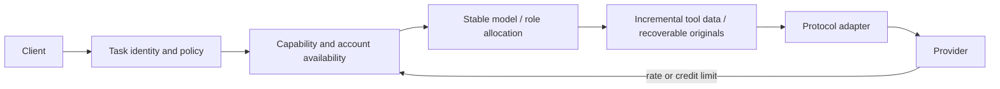

# Bogdan LLM Smart Proxy

Use the right model for the task. Keep useful context cached. Continue through an available account or provider when limits are reached.

A local Docker endpoint for OpenAI Chat Completions, Responses and Anthropic Messages, with task-stable routing, account-aware fallback and the bundled [llm-orchestrator](https://github.com/tbogdan/llm-orchestrator).

## Quick start

Docker Engine and Docker Compose v2 are required. Host Node.js/Python is not required for the proxy itself.

```bash
git clone https://github.com/tbogdan/Bogdan-s-LLM-Smart-Proxy.git
cd Bogdan-s-LLM-Smart-Proxy
./setup.sh
```

Initial setup creates `.env`. Configure one provider credential or enable an existing supported login, then rerun `./setup.sh`. Existing settings are preserved. No account is created and no credits are purchased. A running container does not prove usable provider authentication.

```bash
./setup.sh doctor       # Read-only health, model and orchestration diagnostics
./setup.sh --dry-run    # Preview without changing files or services
./setup.sh --memory     # Optional Graphiti/Neo4j services
./setup.sh --upgrade    # Rebuild checked-out source; preserve configuration/data
./setup.sh --uninstall  # Remove this stack; preserve configuration/data
```

Default endpoint: `http://localhost:18900`. Setup prints your configured port. Authentication and client instructions: [operator guide](docs/operator/setup.md).

## Why use it

- Choose at task start: reuse the orchestrator's task/tier/thinking rules and the proxy's capability filters.
- Keep a route stable: ordinary tool loops and score changes do not move a running task to another model.
- Recover from limits: prefer the same canonical model on another healthy configured account/provider, then a suitable alternative. Rate limits, empty credits and expired credentials are separate conditions.
- Bound model usage: at most three distinct canonical LLMs per task, including proxy helpers and virtual children. Switching account for the proven same model does not add another LLM.
- Reduce repeated context: deterministic tool-data compression with exact originals recoverable on supported non-streaming tool routes. Streaming preserves native transport and passes compression through.
- Verify outcomes: separate configured access, listed models, successful inference, observed cache hits and estimated savings.

## Choose a route

| Need | Setting |
| --- | --- |
| General work, automatic model selection | `auto` |
| Coding with tool support | `auto-coding` |
| Small coding work | `coding-sm` |
| Classification / summaries | `auto-assess`, `auto-memory` |
| Exact model selection | Discovered `family/model` ID |
| Stable identity across requests | `X-LLM-Proxy-Task-ID` plus `X-LLM-Proxy-Client-ID` |
| A new task | Send a new task ID |
| Disable context optimization for a new task | `X-LLM-Proxy-Optimize: off` |

Explicit IDs are preferred. Responses lineage and conversation metadata are reused. When the proxy must infer identity from the conversation anchor, it marks that identity **heuristic**; identical first messages without distinct client/conversation IDs are ambiguous. Echo the returned `X-LLM-Proxy-Task-ID` for reliable continuity.

## Client compatibility

| Client / API | Integration | Boundary |
| --- | --- | --- |
| OpenAI-compatible IDEs and SDKs | Base URL `http://localhost:18900/v1` | Preserve task/conversation IDs where possible |
| Codex / Responses clients | `/v1/responses`, HTTP and WebSocket | Native tools preserved; proxy-hosted children have no host filesystem/shell access |
| Claude Code / Anthropic clients | `/v1/messages`, `/v1/messages/count_tokens` | Client tool schemas and native signatures preserved |
| Windsurf, Claude, Codex, Copilot upstreams | Existing provider adapters/auth helpers | Availability depends on configured account entitlement |
| Legacy API families | Seed/runtime provider union | Listing and actual tool/model compatibility are separate evidence |

Protocol adapters and test results do not imply every version of every IDE has been live-validated. See [limits](docs/operator/limits.md).

## How it works



The orchestrator is shipped in the build; no sibling checkout is needed. Its source version, hashes and license are retained under `vendor/llm-orchestrator/`. Task state, quota observations and originals stay in the local data volume. Optional semantic memory is a separate profile.

## Measure the result

```bash
npm test
node scripts/benchmark-efficiency.js
# Optional: two small model-backed requests; consumes configured account usage.
node scripts/benchmark-efficiency.js --live --base-url http://localhost:18900 --model FAMILY/MODEL
```

The offline benchmark checks a synthetic repeated log with a diagnostic outlier, exact-original recovery and estimated input size. It does **not** prove live model quality, billed savings or cache hits. Live reports keep upstream usage separate from estimates; total cost includes retries, reasoning, helpers and retrieval. No fixed savings percentage is promised.

The [older benchmark](docs/smart-routing-memory-benchmark.md) and [historical README](docs/operator/historical-readme-2026-05.md) are dated evidence, not current pricing or performance guarantees.

## Provider discovery and pricing

```bash
node scripts/refresh-model-catalog.js --mode list --env-file .env --output data/model-inventory.json --catalog-output data/model-catalog-evidence.json
```

This path uses bounded model-list requests and never probes every model's context window. Public pricing evidence is in `data/model-catalog-evidence.json`; subscription credit multipliers and actual account access remain distinct. Unknown price/access is never treated as free or verified.

All 37 provider families have explicit source coverage. Region, plan, currency, context and cache tiers remain separate; unavailable or unpublished prices remain unknown. See [catalog refresh and coverage limits](docs/operator/provider-catalog.md).

## Operations and references

- [Install, authentication, client setup and removal](docs/operator/setup.md)
- [Task limits, compression and fallback boundaries](docs/operator/limits.md)
- Read-only endpoints: `/health`, `/v1/models`, `/v1/capabilities`, `/v1/orchestration`, `/stats`.
- Design references: [Headroom](https://github.com/headroomlabs-ai/headroom) for recoverable context/cache patterns; [Agents Library](https://github.com/cleanunicorn/agents-library) for focused roles and evidence-backed review. These references are not installed as plugins or mandatory services.
- Bundled orchestrator: CC BY 4.0, Bogdan-Gabriel Torcescu; retain its LICENSE/NOTICE and attribution. Proxy package: MIT.
